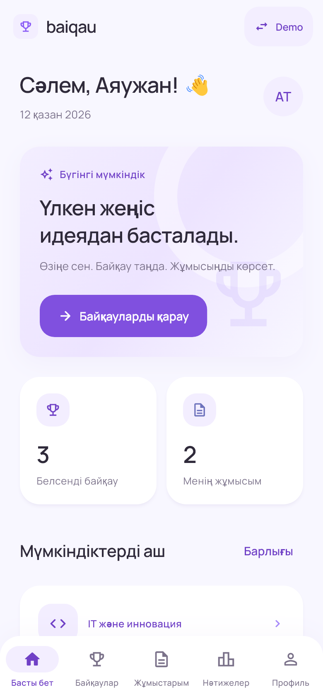
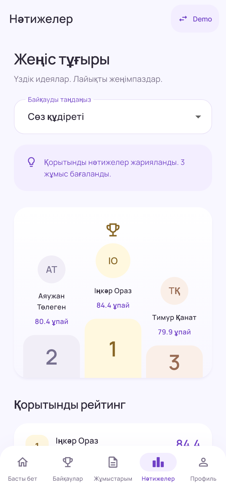

# Мягкий бело-фиолетовый UI

Редизайн текущего Flutter-приложения: светлый фон `#F8F7FF`, белые карточки со скруглением 24 и легкой тенью, лавандовые поверхности `#F3EEFF`, фиолетовые акценты `#8B5CF6`. Manrope сохранен; начертания и межстрочные интервалы стали легче. Для небольших подписей и кнопок используются чуть более глубокие фиолетовые оттенки, сохраняющие читаемость.

## Измененные файлы

| Файл | Изменения |
| --- | --- |
| `lib/theme/app_colors.dart` (новый) | Общая палитра, цвета текста, пастельные статусы и награды. |
| `lib/theme/app_styles.dart` (новый) | Скругления, отступы, тени, лавандовый градиент и запасные шрифты. |
| `lib/theme/app_theme.dart` | ThemeData: типографика, карточки, кнопки, чипы, навигация, поля, диалоги, календарь, слайдеры и уведомления. |
| `lib/widgets/common.dart` | Общий SoftIcon, мягкие статусы, подсказки, статистика, заголовки секций и адаптивные отступы на узких телефонах. |
| `lib/widgets/competition_card.dart` | Легкие карточки конкурсов, единые иконки, пастельные статусы и аккуратная дата. |
| `lib/widgets/submission_card.dart` | Карточки работ, лавандовые аватары, более свободная компоновка. |
| `lib/screens/home_screen.dart` | Светлый hero, статистика, карточки новостей и подсказка; увеличенные интервалы между секциями. |
| `lib/screens/app_shell.dart` | Округлая светлая нижняя панель, pill-подсветка активной вкладки, спокойные иконки и подписи. |
| `lib/screens/results_screen.dart` | Пастельный пьедестал, бейджи мест, мягкое выделение собственной работы и новая компоновка рейтинга. |
| `lib/screens/evaluation_screen.dart` | Карточки критериев, светлый итоговый балл, оформление отзывов. |
| `lib/screens/competition_details_screen.dart` | Лавандовый hero, единые иконки, карточки и отступы. |
| `lib/screens/competitions_screen.dart` | Округлые чипы категорий и мягкие цвета выбранного фильтра. |
| `lib/screens/work_screen.dart` | Общие цвета вторичного текста; обновленные карточки и чипы через тему. |
| `lib/screens/profile_screen.dart` | Лавандовая карточка профиля, светлый аватар, единые награды и иконки. |
| `lib/screens/role_selection_screen.dart` | Мягкие карточки ролей, спокойная типографика, пастельный выбор. |
| `lib/screens/splash_screen.dart` | Светлый splash и фиолетовый знак приложения. |
| `lib/screens/create_competition_screen.dart` | Более свободные отступы формы; поля, календарь и кнопки используют общую тему. |
| `lib/screens/submit_work_screen.dart` | Более свободные отступы формы; поля и кнопки используют общую тему. |
| `android/app/src/main/res/values/colors.xml` | Новые фиолетовый, светлый фон и белая поверхность. |
| `android/app/src/main/res/drawable/baiqau_icon.xml` | Обновленный фиолетовый цвет иконки. |
| `android/app/src/main/res/drawable/launch_background.xml`, `drawable-v21/launch_background.xml` | Светлый Android splash. |
| `android/app/src/main/res/values/styles.xml`, `values-night/styles.xml`, `values-v31/styles.xml` | Единое светлое оформление окна и системных панелей при запуске. |
| `web/index.html`, `web/manifest.json`, `web/icons/Icon.svg` | Цвета браузерной версии и значка приведены к общей палитре. |
| `README.md` | Описание дизайна и новые снимки экранов. |

Провайдеры, модели, хранение, расчет оценок и demo-данные сохранены. Все экраны, пять вкладок, роли, переходы, проверки форм и обработчики действий остаются на месте.

## Проверка

- `scripts/flutter.ps1 analyze`: без замечаний.
- `scripts/flutter.ps1 test`: все 18 существующих тестов прошли, включая навигацию трех ролей на телефоне 320 px и полный сценарий создания, отправки, оценки и публикации.
- Дополнительная визуальная проверка: настоящие Flutter-экраны 390 × 844; формы, роли, конкурс и оценивание проверены на 320 × 720 с масштабом текста 1.3 без переполнения.
- `scripts/flutter.ps1 build apk --debug`: APK собран.
- `scripts/flutter.ps1 build web --release`: web-версия собрана.

## Снимки реализованного интерфейса

Снимки получены из Flutter-виджетов с demo-данными; это реализованные экраны, а не макеты.

| Главная | Результаты |
| --- | --- |
|  |  |

- [Карточки на главной](screenshots/soft-home-cards.png)
- [Новости и подсказка](screenshots/soft-home-news.png)
- [Конкурс](screenshots/soft-details.png)
- [Форма отправки](screenshots/soft-form.png)
- [Оценивание](screenshots/soft-evaluation.png)
- [Выбор роли](screenshots/soft-roles.png)
- [Профиль](screenshots/soft-profile.png)
